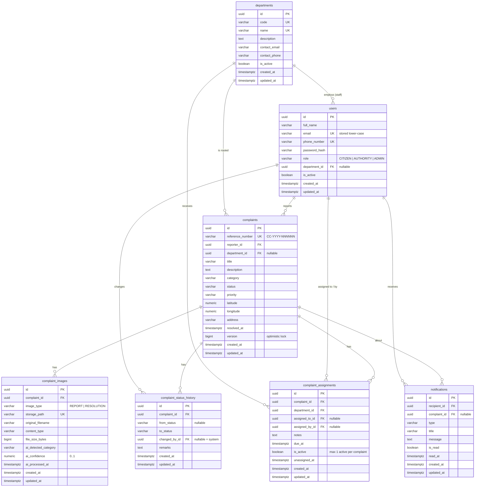

# CivicConnect Database

PostgreSQL schema documentation and local setup.

The schema itself is defined by **Flyway migrations** in
[`backend/src/main/resources/db/migration`](../backend/src/main/resources/db/migration).
That folder is the single source of truth: the backend applies the migrations automatically on startup.

| Migration | Purpose |
|---|---|
| `V1__initial_schema.sql` | All 7 tables, constraints, indexes and the complaint reference number generator |
| `V2__seed_default_departments.sql` | Six default municipal departments |

## Entity-relationship diagram



## Allowed values

| Column | Values |
|---|---|
| `complaints.status` | `SUBMITTED`, `UNDER_REVIEW`, `ASSIGNED`, `IN_PROGRESS`, `RESOLVED`, `REJECTED`, `REOPENED` |
| `complaints.category` | `POTHOLE`, `GARBAGE`, `WATER_LEAKAGE`, `STREETLIGHT`, `ROAD_DAMAGE`, `DRAINAGE`, `OTHER` |
| `complaints.priority` | `LOW`, `MEDIUM`, `HIGH`, `CRITICAL` |
| `users.role` | `CITIZEN`, `AUTHORITY`, `ADMIN` |
| `complaint_images.image_type` | `REPORT`, `RESOLUTION` |
| `notifications.type` | `COMPLAINT_SUBMITTED`, `STATUS_UPDATED`, `COMPLAINT_ASSIGNED`, `COMPLAINT_RESOLVED`, `GENERAL` |

These values are enforced by `CHECK` constraints, not native PostgreSQL `ENUM` types. Adding a value later is a simple constraint change in a new migration.

## Design decisions

- **UUID primary keys.** The application generates time-ordered UUIDv7 values, which keep indexes compact. `gen_random_uuid()` is a fallback default for rows inserted by hand.
- **Delete behaviour:**
  - Deleting a complaint deletes its images, history, assignments and notifications.
  - A user who has reported complaints cannot be deleted (`RESTRICT`). Deactivate them with `is_active` instead.
  - Deleting a staff user sets their references in history and assignments to `NULL`, which keeps the audit trail.
- **Consistency rules enforced by the database:**
  - Emails must be lower-case, which makes uniqueness case-insensitive.
  - `is_read` must match `read_at`, and `is_active` must match `unassigned_at`.
  - An AI result has both a category and a confidence, or neither.
  - Coordinates must be within valid ranges.
  - A complaint can have at most one active assignment.
- **`complaints.department_id`** is the department the complaint is currently routed to, so dashboards don't need a join. `complaint_assignments` keeps the full history of who handled it.
- **Every foreign key is indexed.** There are also indexes for common queries: status plus newest first, category, location (map bounding box), and unread notifications.

## Local setup

### 1. Install PostgreSQL

- **Windows:** download the installer from <https://www.postgresql.org/download/windows/> (EDB). Version 18 is recommended; 13 or newer works. Keep the default port **5432**, remember the `postgres` superuser password, and let the installer register the Windows service.
- **macOS:** `brew install postgresql@18`, then `brew services start postgresql@18`
- **Linux (Debian/Ubuntu):** `sudo apt install postgresql`

Make sure `psql` is on your `PATH`. On Windows, add `C:\Program Files\PostgreSQL\18\bin`.

### 2. Create the database and application user

1. Edit [`scripts/create_local_database.sql`](scripts/create_local_database.sql) and replace `CHANGE_ME` with a password of your choice. Don't commit the real password.
2. Run it as the `postgres` superuser:

   ```bash
   psql -U postgres -h localhost -f database/scripts/create_local_database.sql
   ```

### 3. Configure and start the backend

```bash
cd backend
cp .env.example .env     # set DB_PASSWORD to the password from step 2
./mvnw spring-boot:run
```

On first startup, Flyway logs `Successfully applied 2 migrations`.

### 4. Verify

```bash
psql -U civicconnect -h localhost -d civicconnect -c "\dt"
psql -U civicconnect -h localhost -d civicconnect -c "SELECT version, description, success FROM flyway_schema_history"
```
